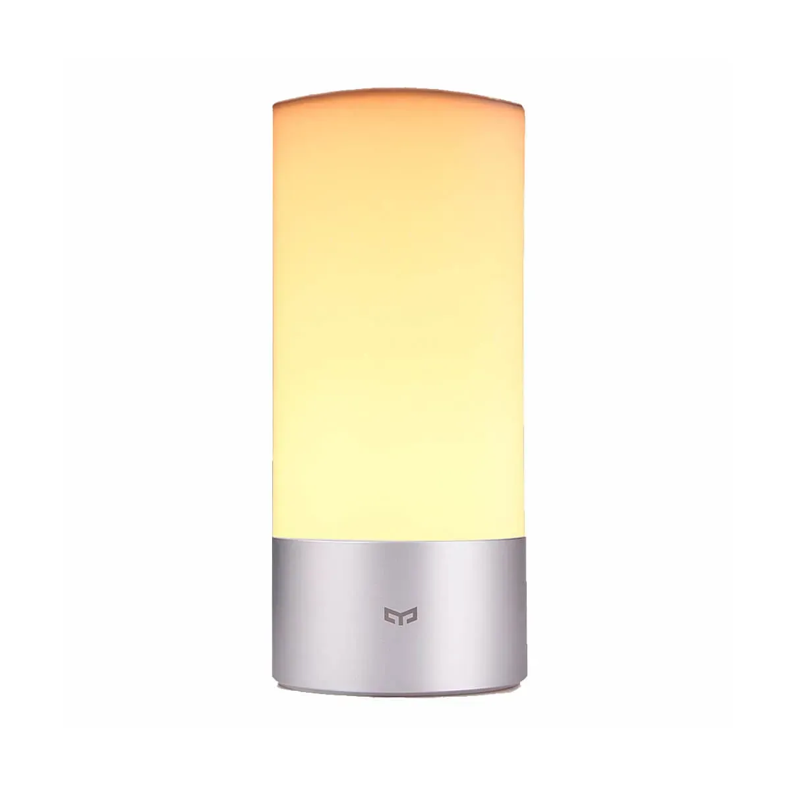
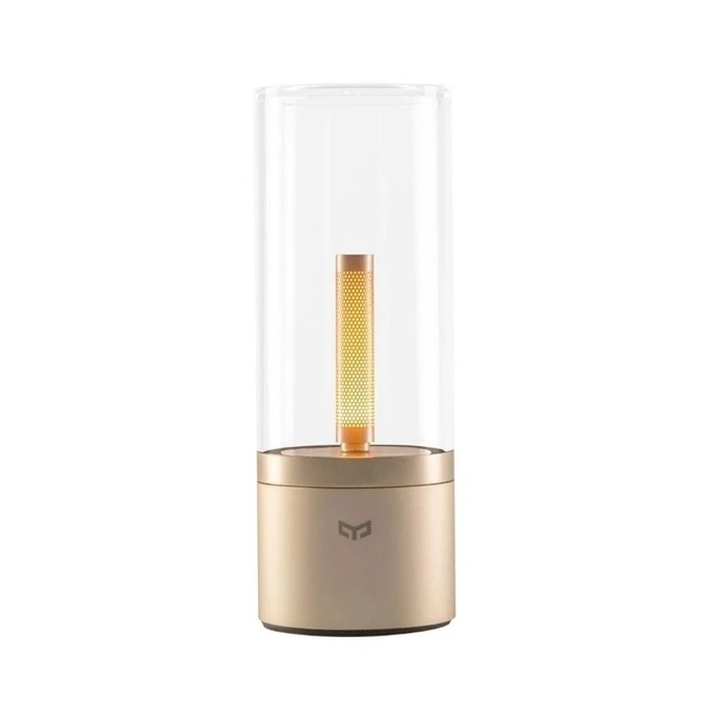

<div align="center">


# Yeelight Bluetooth for Home Assistant

Control the Yeelight **Bedside lamp** and the **Candela** from Home Assistant: locally over Bluetooth, through a Bluetooth adapter or proxy.

[](https://github.com/V4n1X/ha_yeelight_bt/blob/main/CHANGELOG.md)
[](https://www.home-assistant.io/)
[](#installation)
[](https://github.com/V4n1X/ha_yeelight_bt/actions/workflows/validate.yml)
[](https://github.com/V4n1X/ha_yeelight_bt/actions/workflows/tests.yml)
[](https://github.com/V4n1X/ha_yeelight_bt/blob/main/LICENSE)

<table>
  <tr>
    <td align="center"><br><b>Bedside</b><br>color · white · brightness</td>
    <td align="center"><br><b>Candela</b><br>brightness · experimental</td>
  </tr>
</table>

</div>

## Highlights

- Discovered automatically, works with local adapters and Bluetooth proxies (ESPHome)
- Real Kelvin, state changes made on the Bedside are shown immediately
- Robust against dropped connections; failed commands are reported to automations

## Supported lamps

| | Bedside XMCTD01YL | Candela YLFW01YL (micro USB) |
| --- | --- | --- |
| Bluetooth name | `XMCTD_*` | `yeelight_ms*` |
| On / off, brightness 1–100 % | ✓ | ✓ |
| Color, color temperature 1700–6500 K | ✓ | – |
| Changes made on the lamp | shown immediately | shown after confirmed setup authorization with a notification-capable backend; otherwise the last state sent is shown |
| Status | **supported**, tested with real hardware | **experimental** |

**Candela:** the maintainer has no Candela. Its command formats, authorization and state decoding follow the legacy Gingko path in the [Yeelight 3.5.4 APK analysis](https://github.com/V4n1X/ha_yeelight_bt/blob/main/docs/app-ble-protocol.md). This path is not hardware-verified here. Backends unable to enable notifications retain command-only operation, as in [Homey Candela](https://github.com/KevinvOosterhout/com.kevinvanoosterhout.yeelightcandela) and [candelapy](https://github.com/praschak/candelapy). Only the original Bluetooth Candela is supported, with the **switch underneath it in the Bluetooth position**. [Tell us how it works for you.](https://github.com/V4n1X/ha_yeelight_bt/issues/new?template=candela_report.yml)

**Existing Candela entries keep command-only operation after upgrading.** They
continue to work without a new authorization request during startup or polling.
Authorization is tested during new-device setup, when you can turn the cylinder;
only a successfully confirmed identifier is stored for subsequent connections.
If the lamp gives no answer or confirmation times out, setup closes that connection
and tests a fresh command-only connection. On success the entry is created without
a pairing identifier, including when the adapter supports notifications.

## Requirements

- Home Assistant **2026.10** or newer
- [Bluetooth](https://www.home-assistant.io/integrations/bluetooth/) with a local adapter, or an [ESPHome Bluetooth proxy](https://esphome.io/components/bluetooth_proxy.html) with `active: true` and a free connection slot per lamp
- The lamp must **not** be connected to the Yeelight app

## Installation

[](https://my.home-assistant.io/redirect/hacs_repository/?owner=V4n1X&repository=ha_yeelight_bt&category=integration)

Click the button, or add `https://github.com/V4n1X/ha_yeelight_bt` as a custom repository of type *Integration* in the **Marketplace** (Home Assistant 2026.11+) or HACS, and install **Yeelight Bluetooth**.

Manual: extract `yeelight_bt.zip` from the [latest release](https://github.com/V4n1X/ha_yeelight_bt/releases/latest) to `<config>/custom_components/yeelight_bt/` and restart Home Assistant.

## Setup

[](https://my.home-assistant.io/redirect/config_flow_start/?domain=yeelight_bt)

Lamps in range show up as discovered under **Settings → Devices & services**; lamps without a name can be added with their MAC address. Home Assistant connects to the lamp before the setup finishes.

- **Bedside**: if it was used with another device, [reset it](https://www.youtube.com/watch?v=PnjcOSgnbAM) first. When it **pulses** during the setup, push its small button within 60 seconds. It only pulses while it is on: if nothing happens, switch it on at the lamp.
- **Candela**: charge it and put the switch underneath it in the Bluetooth position. If it requests authorization, turn its cylinder within 60 seconds. Without an answer or confirmation, setup retries a connection for basic control. Backends without notification support use command-only operation directly.

Afterwards, do not connect the lamp to the Yeelight app anymore. **Reconfigure** in the ⋮ menu of the lamp changes the model if it was detected wrongly.

## How it works

- The **Bedside** pushes its state while connected and is asked for it every 30 s (can be turned off with *Enable polling* in the system options).
- The **Candela** is also polled every 30 s for entries authorized during setup when notifications are available. Older entries and backends without notification support show the last state Home Assistant sent and restore it after a restart.
- A lamp that cannot be reached becomes **unavailable** when a command or a supported 30 s update fails (after about a minute) and is retried every 30 s.
- On every connection Home Assistant sets the **Bedside clock** to its local time, like the Yeelight app does. The lamp's own timers use this clock.
- If a lamp no longer accepts Home Assistant (for example after it was deleted in the Yeelight app or reset), a **repair issue** asks you to switch it on and push its button while it pulses.
- The device page offers **diagnostics** with the lamp state and the adapter or proxy in use.

**Known limitations**

- No transitions and no effects; the lamps fade at their own speed. The Candela's built-in flame mode cannot be selected.
- The Bedside ignores commands for about 1 s after switching on, so turning it on with a color or brightness takes about 2.5 s.
- Only one device can be connected to a lamp: while Home Assistant is connected, the Yeelight app cannot connect.
- Every lamp occupies a connection slot of a Bluetooth proxy (ESPHome: 3 by default). Shelly devices cannot connect to lamps.

<details>
<summary><b>Example: wake-up light</b></summary>

```yaml
alias: Wake-up light
triggers:
  - trigger: time
    at: "06:30:00"
actions:
  - action: light.turn_on
    target:
      entity_id: light.bedside
    data:
      color_temp_kelvin: 2700
      brightness_pct: 10
  - delay: "00:10:00"
  - action: light.turn_on
    target:
      entity_id: light.bedside
    data:
      color_temp_kelvin: 4000
      brightness_pct: 80
```
</details>

<details>
<summary><b>Example: night light on motion</b></summary>

```yaml
alias: Bedroom night light
mode: restart
triggers:
  - trigger: motion.detected
    target:
      area_id: bedroom
actions:
  - action: light.turn_on
    target:
      entity_id: light.bedside
    data:
      color_temp_kelvin: 1700
      brightness_pct: 5
  - wait_for_trigger:
      - trigger: motion.cleared
        target:
          area_id: bedroom
        options:
          behavior: all
          for: "00:02:00"
  - action: light.turn_off
    target:
      entity_id: light.bedside
```
</details>

## Troubleshooting

- **Not discovered or unavailable**: close the Yeelight app (or turn off Bluetooth on the phone), check that the lamp shows up in the **Bluetooth → Advertisement monitor**, and move the adapter or proxy closer. A Candela needs its switch in the Bluetooth position.
- **Bedside does not react after a reset or after it was deleted in the Yeelight app**: it waits to be paired again. Switch it on at the lamp; it pulses and waits for its button to be pushed.
- **Bug reports**: enable *debug logging* on the integration page, reproduce the problem and attach the log to a [bug report](https://github.com/V4n1X/ha_yeelight_bt/issues/new?template=bug_report.yml), with Bluetooth addresses replaced by placeholders.

## Migrating from hcoohb/hass-yeelightbt

This project continues [hcoohb/hass-yeelightbt](https://github.com/hcoohb/hass-yeelightbt) with the same domain, so your lamps, entities and automations keep working. Remove the old repository in the Marketplace/HACS (keep the integration configured), install this one and restart Home Assistant. See the [changelog](https://github.com/V4n1X/ha_yeelight_bt/blob/main/CHANGELOG.md) for all changes.

> [!IMPORTANT]
> **Color temperature is real Kelvin now.** Version 1.x shifted the values: 2740 K in Home Assistant became about 4080 K on the lamp. Automations and scenes with a color temperature look different after the update; use about 4000 K for neutral white.

## Removing

Delete the lamp under **Settings → Devices & services → Yeelight Bluetooth**, then remove the repository in the Marketplace/HACS. When the lamp is in reach, deleting it also removes the pairing on the lamp, so adding it again needs its button. The Bedside shares this pairing with the Yeelight app: deleting it in Home Assistant signs it out of the app as well, and the other way round. To use a Bedside with the Yeelight app again, [reset it](https://www.youtube.com/watch?v=PnjcOSgnbAM) or add it in the app (switched on, push its button when it pulses).

## Contributing

Bug reports, Candela test reports and pull requests are welcome. Run the tests with `pip install -r requirements-dev.txt` and `pytest` (Linux or WSL). The hardware test checklist is in [docs/hardware-test.md](https://github.com/V4n1X/ha_yeelight_bt/blob/main/docs/hardware-test.md).

Please keep personal data such as Bluetooth addresses, host names and tokens out of the repository. After cloning, enable the checks with `git config core.hooksPath .githooks`; your own patterns can be added to `.git/info/private-patterns`, which is never committed. The same checks run in CI.

## Credits and license

Based on [hcoohb/hass-yeelightbt](https://github.com/hcoohb/hass-yeelightbt) by [@hcoohb](https://github.com/hcoohb), originally inspired by [python-yeelightbt](https://github.com/rytilahti/python-yeelightbt) by Teemu Rytilahti, with community work from [#79](https://github.com/hcoohb/hass-yeelightbt/pull/79), [#80](https://github.com/hcoohb/hass-yeelightbt/pull/80), [#81](https://github.com/hcoohb/hass-yeelightbt/issues/81) and the [mhdsallal fork](https://github.com/mhdsallal/hass-yeelightbt).

The code is licensed under the [MIT license](https://github.com/V4n1X/ha_yeelight_bt/blob/main/LICENSE). The product pictures belong to Yeelight, see [docs/images/NOTICE.md](https://github.com/V4n1X/ha_yeelight_bt/blob/main/docs/images/NOTICE.md). This project is not affiliated with Yeelight or Xiaomi.
